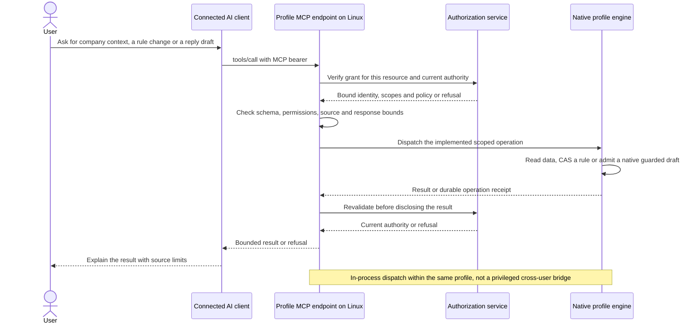

# Operator data flows

<!-- doc-scope:start -->
Scope: current operator backend ownership, request flow and authority boundaries,
with routes to fixed source/build evidence and earlier design sequences. Native
GUI, runtime activation and provider acceptance remain separate from source proof.
<!-- doc-scope:end -->

## Current source and product boundary

Desktop is required for sign-in, account/service/operator configuration and client
access. Daily work uses one configured remote MCP in the AI client; users need no
local clone, Python, Git, terminal, local skill or second MCP. Opted-in ordinary
rule changes save directly from chat with revisions and recovery. Initial native
management and legacy import/decision operations retain their owner protections.

The [current-main integration](execution-plans/2026-11-06-operator-mcp-main-integration.md)
contains the profile Linux MCP server, central authorization/grant components,
scoped native readers, rule CAS/history, pricing/projects and normal-engine draft
preparation/recovery. The [paired source contract](operator-source-build.md)
identifies exact source, resources, checks and retained limits. Current source
registration does not establish a newly packaged configurator GUI or a new
installed service. Dated real-client acceptance belongs to the parent operator
workstream; controlled package fixtures do not replace it.

An AI-provider account and the MrCall Firebase profile are distinct identities.
The broker's opaque MCP token authorizes one profile resource. It does not become
a Firebase ID token or pass through the Firebase-only engine WSS boundary.
Native owner requests have a separate authenticated request context.

## Authorized daily request

The client connection grants only implemented scoped workflows. A full delegation
supports feature growth without recurring feature-specific OAuth. Source/data
coverage and capabilities remain explicit; a missing source is not evidence that
no such source exists. General engine RPC parity is not established by this slice.

## Durable changes and cost

Canonical managed instructions use current company rights and expected revisions.
Retries have stable operation keys; history and restore retain prior content.
Native legacy decision/import endpoints cannot be authorized by mail content or
a delegated MCP bearer. Kernel scheduled sessions retain their protected denials.
Standing instructions do not grant sending, payment, budget or tool permissions.

Reply generation uses the native engine budget and one causal reservation. Native
enrollment, assignment, exact source/recipient and claim controls remain in force.
Draft and saved-result mutation share the private writer transaction; instruction
revisions are checked while the native company writer guard is held. Recovery
reads the saved result without another model call. No sending tool or alternate
send path is added. Internal review can finish without a customer draft.

An AI-chat attachment, a shared project record and a local filesystem path are
different sources. A path alone transfers no bytes. The MCP does not grant general
local filesystem access; unread attachments and partial correspondence retain
those coverage limits. Uploaded/native file workflows remain separately owned.

## Code and verification routes

- [HTTP/tool server](../engine/zylch/operator_mcp/server.py), [authorization](../engine/zylch/operator_mcp/auth.py) and [resource routing](../engine/zylch/operator_mcp/routing.py).
- [Issuer](../engine/zylch/operator_mcp/issuer.py) and [grant persistence](../engine/zylch/operator_mcp/broker_store.py).
- [Native reads](../engine/zylch/operator_mcp/read_port.py), [effects](../engine/zylch/operator_mcp/effects.py) and [saved reply operations](../engine/zylch/services/operator_reply_operations.py).
- [Rule changes](../engine/zylch/services/operator_rule_changes.py) and [native management](../engine/zylch/rpc/operator_operations.py).
- [Identity, company memory and spending](cross-cutting-contracts.md), [IPC](ipc-contract.md) and [host operations](remote-backend.md).

## Earlier design sequences

The dated [onboarding brief](briefs/2026-09-10-desktop-to-operator-onboarding.md)
and the earlier [authentication](operator-data-flows/authentication.md),
[tool](operator-data-flows/tools.md), [file/lifecycle](operator-data-flows/files-and-lifecycle.md)
and [local-connector](operator-data-flows/local-connector.md) sequences retain the
original proposal and local nine-tool prototype. Their candidate counts,
unimplemented labels, optional/local setup, isolated quota and workspace/STDIO
choices describe that historical design. The source/build contract above owns
current backend behavior. Those sequences do not require a local connector or
workspace installation for daily remote users, and do not certify current GUI,
provider, automatic-bootstrap or release acceptance.
