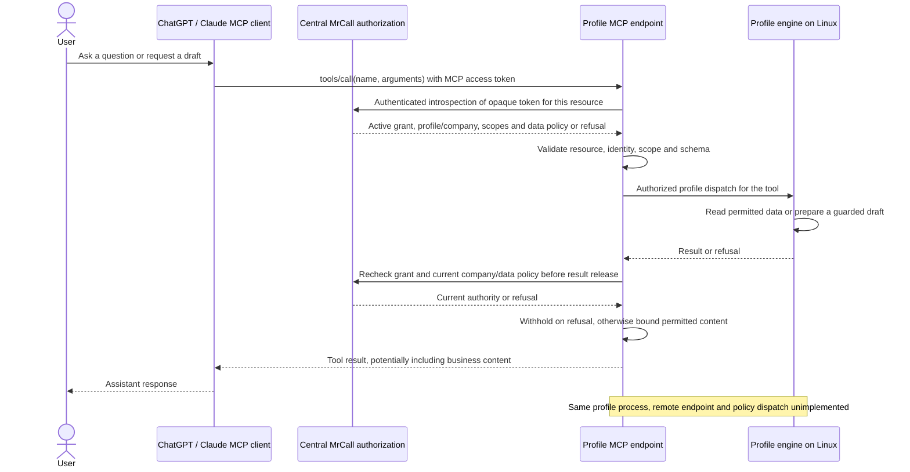

# Operator data flows

<!-- doc-scope:start -->
Scope: entry point, remote-request overview and implementation-status boundaries for the English Desktop and operator MCP sequences. Detailed flows explain the remote extension specified by the existing onboarding brief, without claiming implementation or release.
<!-- doc-scope:end -->

**Implementation boundary:** Desktop Firebase authentication and its WSS engine connection exist on `main`. The nine-tool local MCP exists only as an **uncommitted, unreleased candidate in isolated `feat/desktop-operator-mcp-20261008` worktrees** and is **absent from main**. Remote MCP, OAuth, the authorized engine/workspace bridge and company-project file upload in this design are **unimplemented proposals**.

A ChatGPT or Claude account is independent of the MrCall Firebase UID. OAuth consent would link a particular AI client to an authorized MrCall profile and company; it would not make the two accounts the same identity. The proposed MCP access token must never pass through the existing Firebase-only WSS authentication boundary.

No general local filesystem access is provided by these nine candidate tools. An AI conversation attachment, a future MrCall upload, and a separately authorized local filesystem tool are different paths. A path or MCP root alone transfers no bytes.

## Proposed remote request flow

This overview shows a successful authorized request to the unimplemented remote service. Refusal branches are detailed in case 4.
The MCP endpoint and engine methods live in the same profile Linux process.
The central authorization service owns grants; internal dispatch is not a
privileged bridge across Unix users. These are design decisions, not live services.

## Implementation status and navigation

| Area | Status | Sequences |
|------|--------|-----------|
| Desktop login and authenticated engine WSS | Existing on main | [1 · Desktop login](operator-data-flows/authentication.md#1--first-mrcall-desktop-login) |
| Remote MCP login and session | Unimplemented proposal; profile endpoint and central introspection are selected | [3 · OAuth and 4 · session](operator-data-flows/authentication.md) |
| Nine-tool mapping | Isolated local candidate only; uncommitted, unreleased, absent from main | [5 · reads, 6 · context, 7 · ask, 8 · draft](operator-data-flows/tools.md) |
| Files and remote lifecycle | Limited local candidate; upload/general filesystem extensions and remote revocation unimplemented | [9 · files and 10 · lifecycle](operator-data-flows/files-and-lifecycle.md) |
| Workspace and STDIO connector | Claude Desktop preview only; client installation acceptance unverified | [2 · workspace and 11 · local connector](operator-data-flows/local-connector.md) |

The candidate transport uses the SDK 1.x `initialize` / `notifications/initialized` pattern and negotiated 2025 protocol compatibility. Real remote clients must negotiate a supported version; this is not a claim that every current client uses that handshake unchanged. Remote MCP-to-engine arrows mean in-process policy dispatch within one profile, not Firebase WSS or a cross-user privileged bridge.

## Remote product decisions

The remote endpoint lives in each Linux profile engine; central authorization issues opaque, profile-resource-bound tokens and introspects grants without a positive cache. Consent separates read, paid ask and draft scopes, with company policy and source-class filtering. Qonto/finance and PEC are excluded by default. Paid calls use an isolated MCP allocation; audit excludes message bodies. Remote procedures have one revisioned engine authority and remote drafts require native result identity/idempotency.

See [12 · company policy, 13 · quota/audit, 14 · procedures and 15 · native drafts](operator-data-flows/tools.md#remote-access-cost-and-errors). These requirements are unimplemented. Desktop logout leaves remote grants active; explicit revocation or company/security events invalidate them. Revocation cannot undo admitted work or already disclosed content.

## Evidence and related contracts

Existing contracts are described in [remote backend](remote-backend.md), [IPC contract](ipc-contract.md), [cross-cutting runtime contracts](cross-cutting-contracts.md) and [operator setup](operator-setup.md). The [existing onboarding brief](briefs/2026-09-10-desktop-to-operator-onboarding.md#remote-mcp-design-decisions--unimplemented-extension) owns the remote design decisions alongside its original coding-agent delivery.

Existing Desktop main code: [Firebase sign-in UI](../app/src/renderer/src/views/SignIn.tsx), [Desktop session integration](../app/src/main/index.ts), [WSS client](../app/src/main/wsRpcClient.ts) and [engine WSS authentication](../engine/zylch/rpc/server_ws.py). These links point to main code, not the MCP candidate.

Candidate provenance: isolated `feat/desktop-operator-mcp-20261008` worktrees contain the uncommitted cs-kernel modules `cs/desktop_mcp.py` and `cs/desktop_managed.py`, plus Desktop `app/src/main/operatorWorkspace.ts`. These names are textual references because the candidate is absent from main. Candidate source, SDK and browser-fixture tests and Linux frozen discovery were verified; actual provider installation, macOS/Windows execution and genuine Firebase authentication remain unverified. This evidence does not establish release or provider acceptance.

Official references: [OpenAI plugin authentication](https://developers.openai.com/plugins/build/auth), [Claude remote MCP connectors](https://support.claude.com/en/articles/11175166-get-started-with-custom-connectors-using-remote-mcp), [MCP authorization specification](https://modelcontextprotocol.io/specification/2026-07-28/basic/authorization), [OAuth token introspection](https://www.rfc-editor.org/rfc/rfc7662) and [MCP 2025 lifecycle specification](https://modelcontextprotocol.io/specification/2025-06-18/basic/lifecycle). These references describe external protocol/client contracts; they do not establish that MrCall has implemented the proposed remote service.
