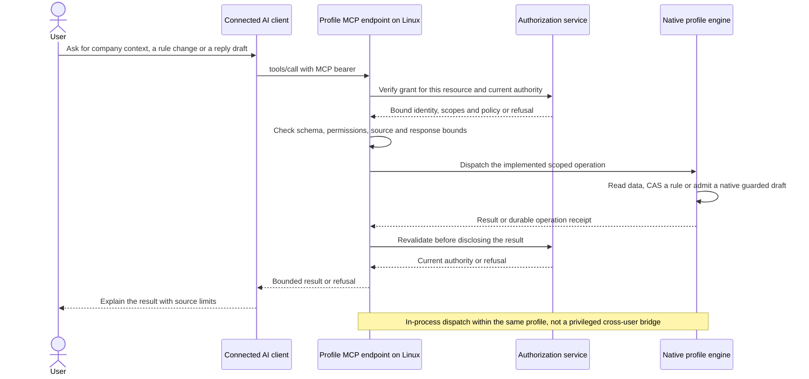

# Operator data flows

<!-- doc-scope:start -->
Scope: current operator backend ownership, request flow and authority boundaries,
with routes to fixed source/build evidence and earlier design sequences. Native
GUI, runtime activation and provider acceptance remain separate from source proof.
<!-- doc-scope:end -->

## Current source and product boundary

Desktop is required for sign-in, account/service/operator configuration and client
access. Daily work uses one configured remote MCP in the AI client; users need no
local clone, Python, Git, terminal, local skill or second MCP. Opted-in ordinary
rule changes save directly from chat with revisions and recovery. Initial native
management and legacy import/decision operations retain their owner protections.

The [retained integration plan](execution-plans/2026-11-06-operator-mcp-main-integration.md)
records the baseline profile MCP, authorization, native readers, rule history,
pricing/projects and draft preparation. Its [dev1 paired source contract](operator-source-build.md)
identifies fixed historical package inputs and limits. The [mailbox contract](mailbox-drafts.md)
owns the current candidate's native draft flow. Source registration does not
establish a newly packaged configurator GUI or a new installed service. Dated real-client acceptance belongs to the parent operator
workstream; controlled package fixtures do not replace it.

An AI-provider account and the MrCall Firebase profile are distinct identities.
The broker's opaque MCP token authorizes one profile resource. It does not become
a Firebase ID token or pass through the Firebase-only engine WSS boundary.
Native owner requests have a separate authenticated request context.

## Authorized daily request

The client connection grants only implemented scoped workflows. A full delegation
supports feature growth without recurring feature-specific OAuth. Source/data
coverage and capabilities remain explicit; a missing source is not evidence that
no such source exists. General engine RPC parity is not established by this slice.

## Durable changes and cost

Canonical managed instructions use current company rights and expected revisions.
Retries have stable operation keys; history and restore retain prior content.
Native legacy decision/import endpoints cannot be authorized by mail content or
a delegated MCP bearer. Kernel scheduled sessions retain their protected denials.
Standing instructions do not grant sending, payment, budget or tool permissions.

Reply generation uses the native engine budget and one causal reservation. The
request is a person's: it is admitted on every assignment state, and keeps the
exact source and recipient binding and the claim controls. The [mailbox candidate](mailbox-drafts.md) creates the sole native Gmail draft
through the engine. Generation retains source and instruction digests and a
causal receipt, without a saved editable body. The final provider effect checks
current instruction revisions under the company writer guard after reserving
its durable operation identity. Recovery resolves the original operation without
another generation or blind provider retry. Internal review can finish without
a customer draft. The mailbox implementation runs on the seven hosted engines; current installed
versions and remaining acceptance are in the living context and delivery plan.

`send_reply` is the one MCP sending tool. It needs full operator access
(`operator.use`) and is idempotent on its request key. The server exposes a
separate destructive tool and validates its grant; each client owns its
presentation and approval interaction. In the mailbox candidate it
sends the named native draft with its current MIME and recipients, including
Gmail edits. A missing draft is never recreated. Only exact Message-ID proof in
Sent confirms delivery; uncertainty remains attached to the original operation
across restarts and triggers reads, never another transmission. `delete_draft`
moves the named native draft to recoverable Trash. Scheduled operators never
carry person-request authority; their separate engine composition checks Sent
and existing drafts before generation and can send directly only when the
ordinary launcher permits it.

An AI-chat attachment, a shared project record and a local filesystem path are
different sources. A path alone transfers no bytes. The MCP does not grant general
local filesystem access; unread attachments and partial correspondence retain
those coverage limits. Uploaded/native file workflows remain separately owned.

## Code and verification routes

- [HTTP/tool server](../engine/zylch/operator_mcp/server.py), [authorization](../engine/zylch/operator_mcp/auth.py) and [resource routing](../engine/zylch/operator_mcp/routing.py).
- [Issuer](../engine/zylch/operator_mcp/issuer.py) and [grant persistence](../engine/zylch/operator_mcp/broker_store.py).
- [Native reads](../engine/zylch/operator_mcp/read_port.py), [effects](../engine/zylch/operator_mcp/effects.py) and [saved reply operations](../engine/zylch/services/operator_reply_operations.py).
- [A person's request marker](../engine/zylch/services/person_request.py), [native mailbox draft operations](../engine/zylch/services/mailbox_drafts.py), [durable identities](../engine/zylch/storage/mailbox_operations.py) and [native sending](../engine/zylch/services/mailbox_draft_send.py).
- [Rule changes](../engine/zylch/services/operator_rule_changes.py) and [native management](../engine/zylch/rpc/operator_operations.py).
- [Identity, company memory and spending](cross-cutting-contracts.md), [IPC](ipc-contract.md) and [host operations](remote-backend.md).

## Earlier design sequences

The dated [onboarding brief](briefs/2026-09-10-desktop-to-operator-onboarding.md)
and the earlier [authentication](operator-data-flows/authentication.md),
[tool](operator-data-flows/tools.md), [file/lifecycle](operator-data-flows/files-and-lifecycle.md)
and [local-connector](operator-data-flows/local-connector.md) sequences retain the
original proposal and local nine-tool prototype. Their candidate counts,
unimplemented labels, optional/local setup, isolated quota and workspace/STDIO
choices describe that historical design. The retained dev1 source/build contract owns only that fixed package. The
mailbox contract above owns the current candidate backend behavior. Those sequences do not require a local connector or
workspace installation for daily remote users, and do not certify current GUI,
provider, automatic-bootstrap or release acceptance.
