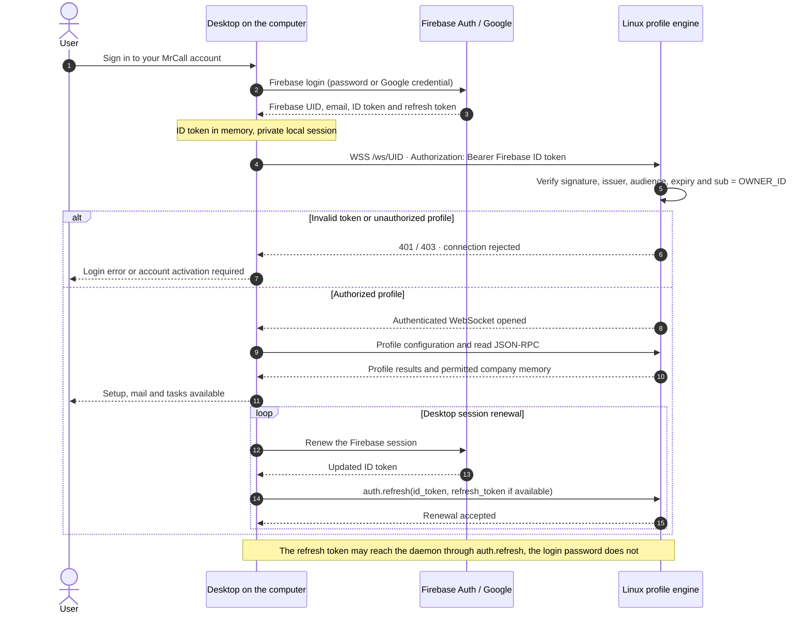
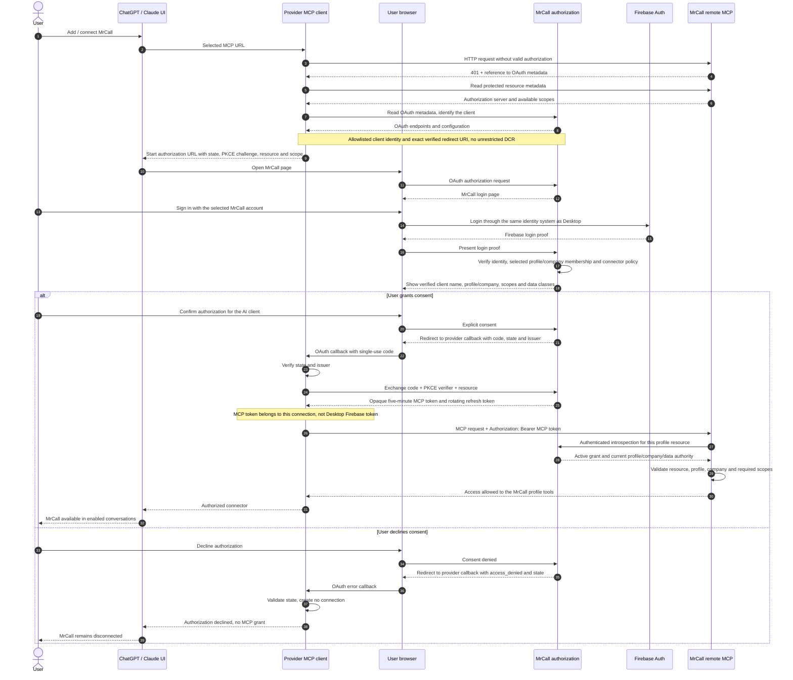
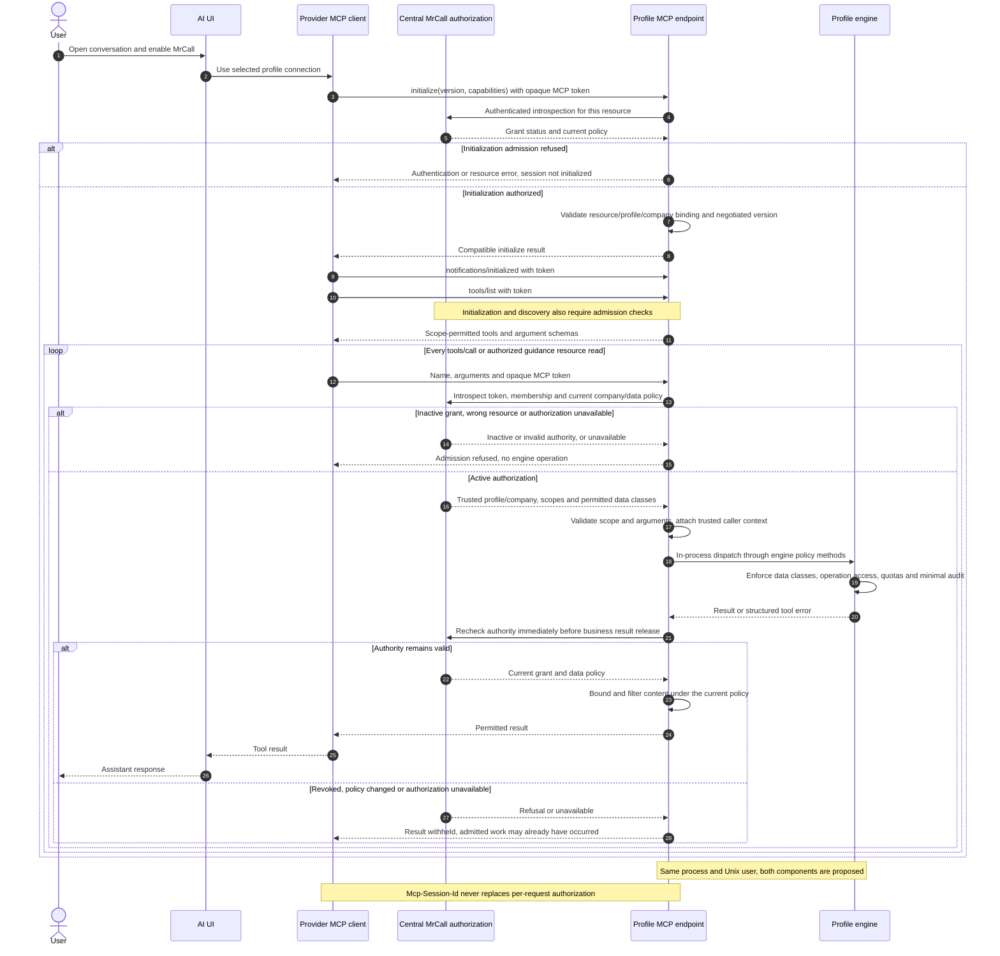

# Authentication and sessions

<!-- doc-scope:start -->
Scope: English sequence descriptions for authentication and sessions; existing behavior, isolated candidate behavior and unimplemented proposals are explicitly distinguished.
<!-- doc-scope:end -->

[Back to the data-flow index](../operator-data-flows.md).

Implementation status and transport boundaries: [data-flow index](../operator-data-flows.md#implementation-status-and-navigation). Each case labels existing, candidate or proposed behavior.

## 1 · First MrCall Desktop login

**Status: EXISTING ON MAIN — verified code.**

This case assumes a remote backend is already activated. Login identifies the profile; it does not automatically provision a hosted tenant. Firebase UID is the identity, not the email. Google and email/password login are alternative paths.

## 3 · Connecting ChatGPT or Claude to MrCall

**Status: UNIMPLEMENTED PROPOSAL — remote MCP and OAuth.**

AI UI means the app/web interface; MCP client means the provider component making remote requests. Browser login and token exchange are separate flows. The MrCall password and Firebase session are not handed to the AI client. Claude explicitly documents connections from its cloud infrastructure.

## 4 · MCP session and per-call checks

**Status: UNIMPLEMENTED REMOTE PROPOSAL — tool design based on the local candidate.**

The profile's MCP endpoint and engine methods share one Linux process and Unix user.
They dispatch internally through engine policies, without passing MCP tokens to
Firebase WSS. The central authorization service owns the grant store. Streamable
HTTP session IDs identify protocol sessions, never authorization. Every request
requires a valid resource-bound token; version negotiation is independent of identity.

