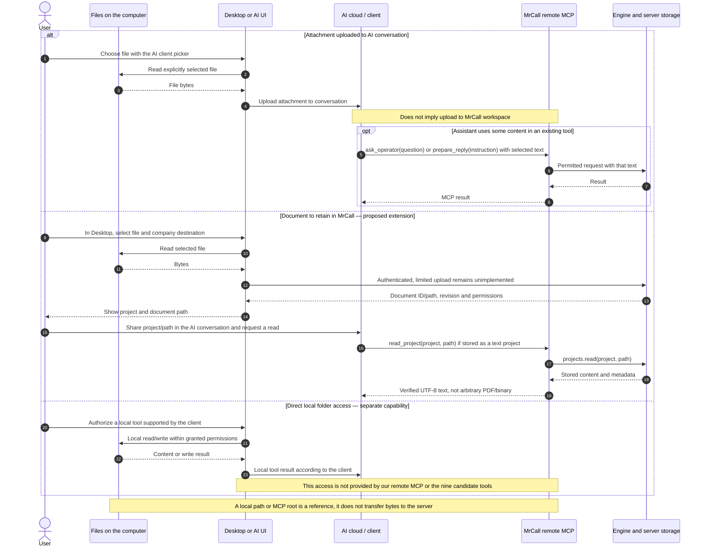
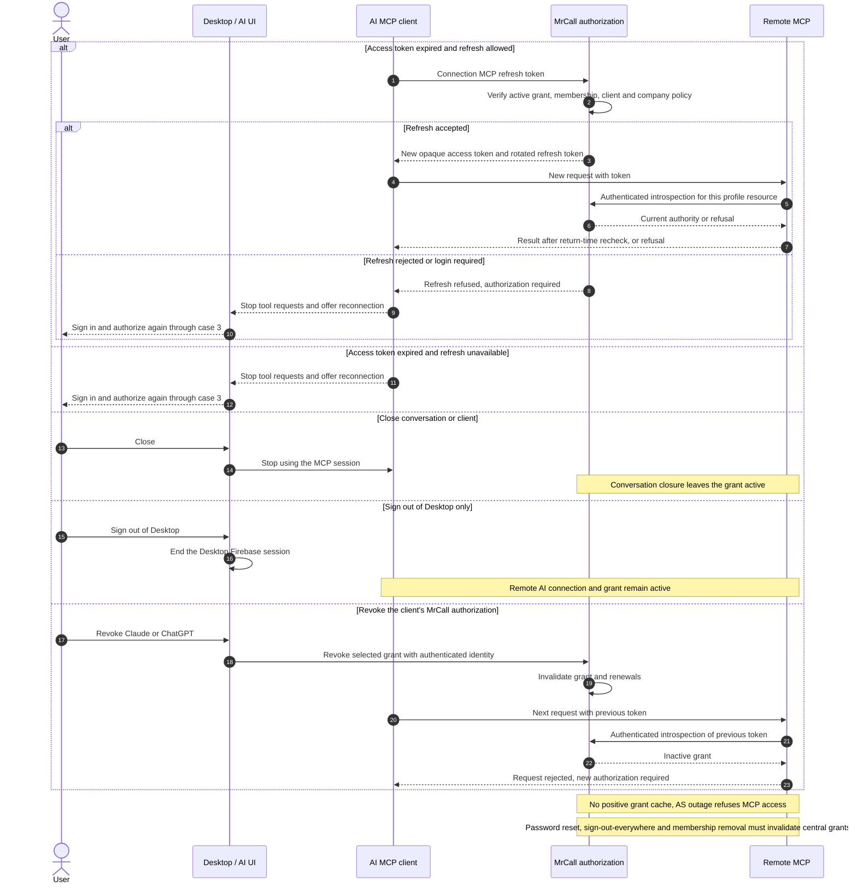

# Files and connection lifecycle

<!-- doc-scope:start -->
Scope: English sequence descriptions for files and connection lifecycle; existing behavior, isolated candidate behavior and unimplemented proposals are explicitly distinguished.
<!-- doc-scope:end -->

[Back to the data-flow index](../operator-data-flows.md).

Implementation status and transport boundaries: [data-flow index](../operator-data-flows.md#implementation-status-and-navigation). Each case labels existing, candidate or proposed behavior.

## 9 · Files on the computer: three separate cases

**Status: LIMITED LOCAL CANDIDATE / UNIMPLEMENTED EXTENSIONS.**

The candidate MCP exposes no read_file, write_file, upload_file, download_file or shell. read_project reads engine documents; operator_context reads only canonical workspace files. The company-project upload and general local-access branches below are proposals, not implemented capabilities of this MCP. Existing Desktop chat attachment-transfer workflows are separate from the proposed company-project upload.

## 10 · Remote connection renewal, closure and revocation

**Status: UNIMPLEMENTED PROPOSAL — revocation policy.**

Revoking an AI-client grant and signing out of Desktop are distinct events. Desktop logout does not revoke remote grants in the proposed product; the local candidate revokes on logout. Acknowledged revocation stops new admissions through uncached introspection; return-time checks withhold results when authority has changed. It does not retract data already shown or roll back admitted work.

Tokens expire after five minutes; grants expire after 90 days without admitted use.
Explicit revocation, company disable and removal of company membership also refuse
refresh. Security-event integration must invalidate the central store; Firebase
session invalidation alone does not invalidate an independently issued MCP grant.
Already-admitted model calls or draft writes may finish after revocation; their
results are withheld if the return-time check fails. Audit and Desktop operation
inspection remain available to the authorized profile user.
