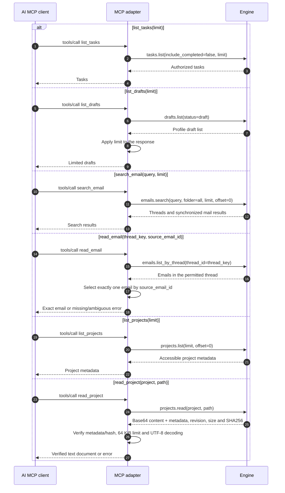
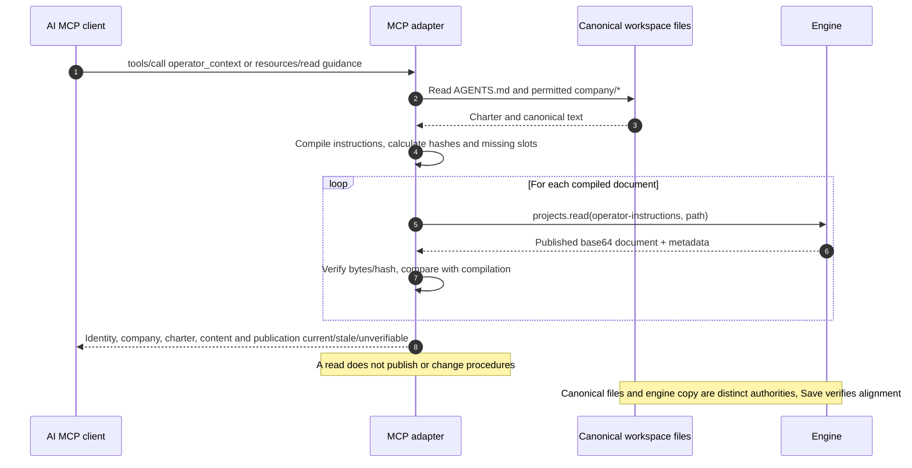
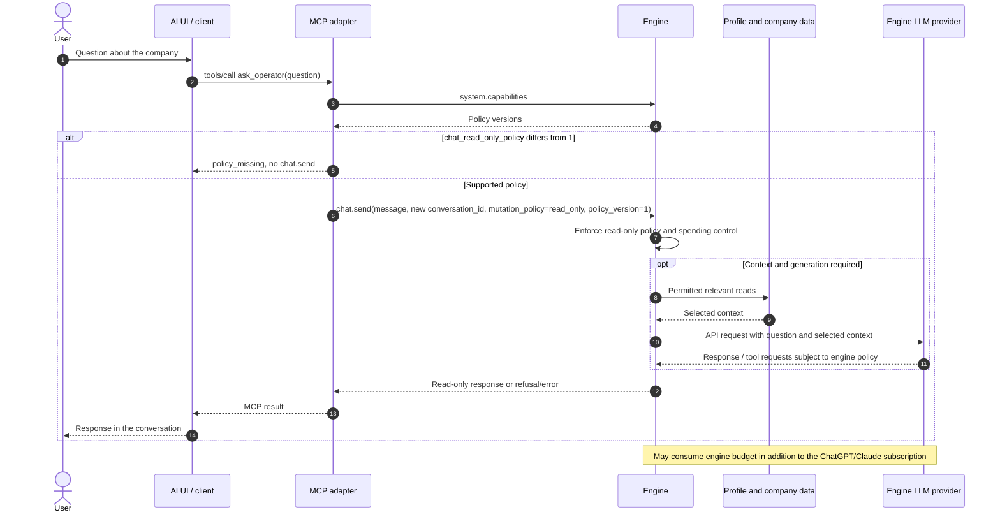
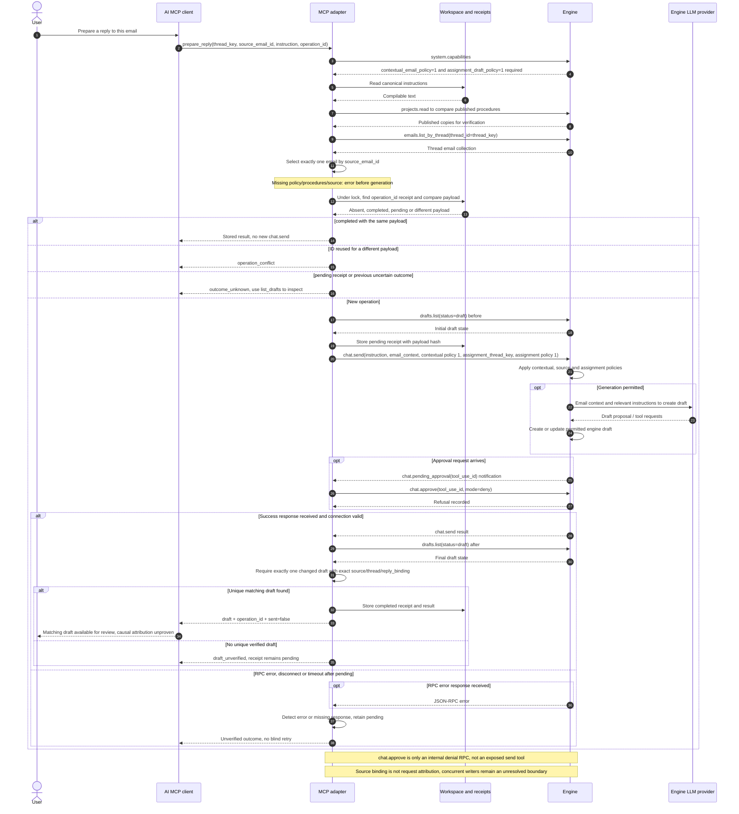
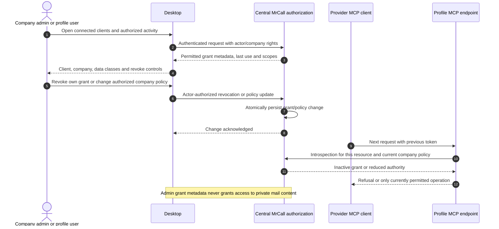
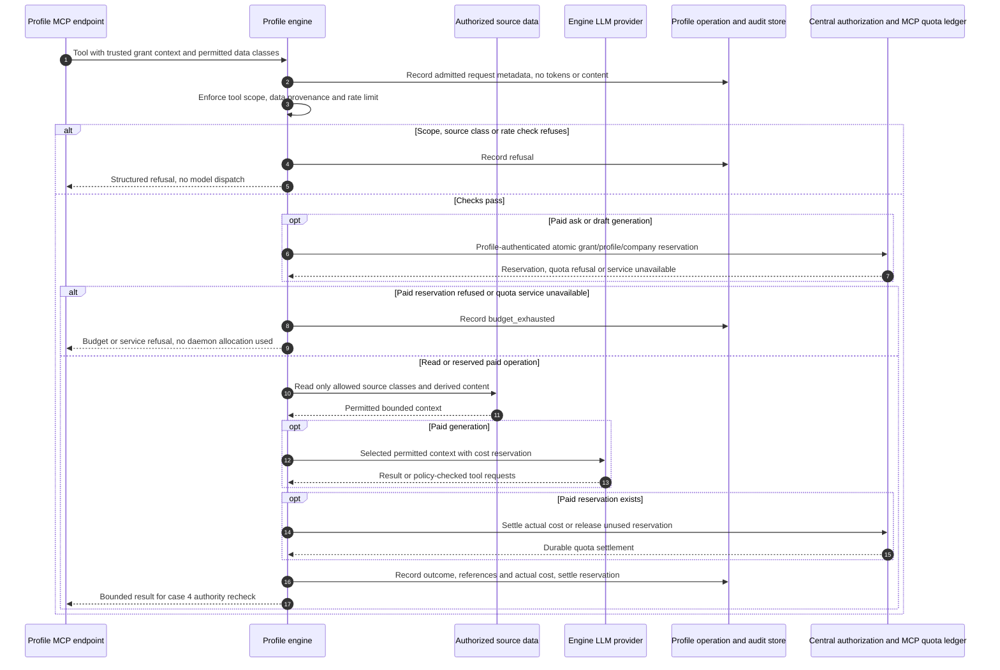
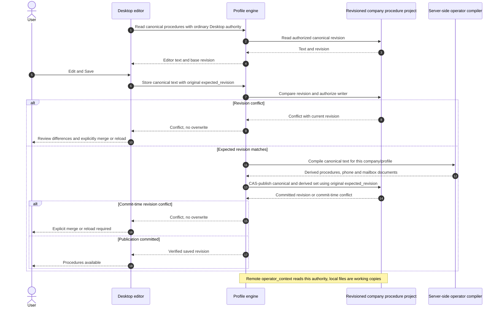
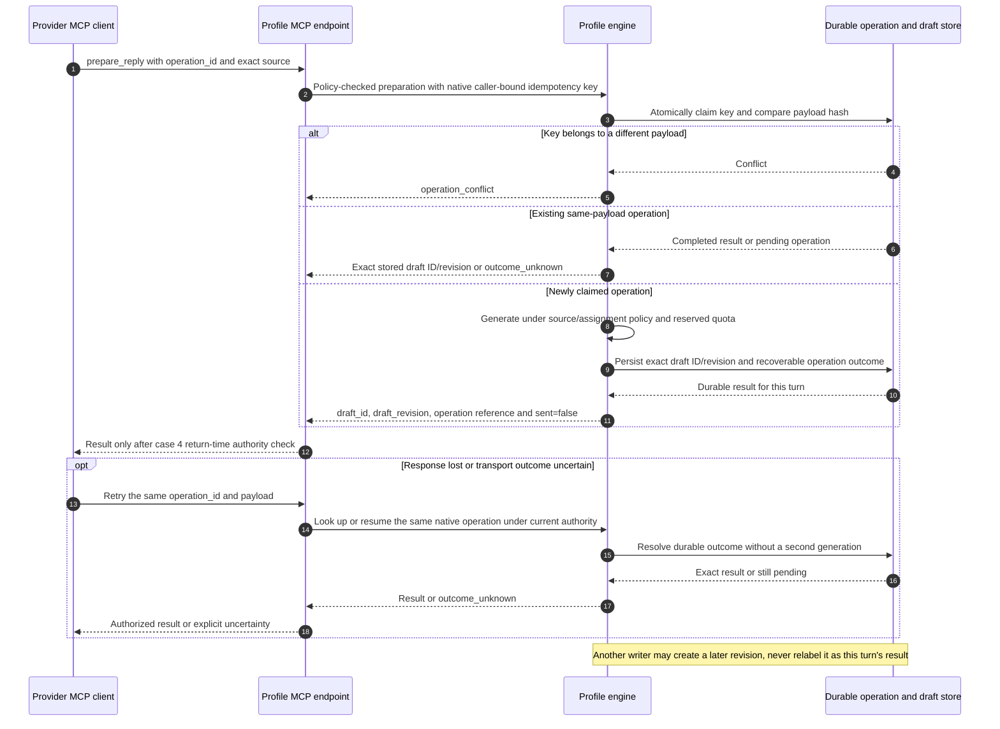

# Tools and engine RPC mapping

<!-- doc-scope:start -->
Scope: sequence descriptions for candidate tools and engine RPC mapping, plus proposed remote governance, budgets, audit, procedure authority and native draft identity. Existing, candidate and proposed behavior remain separate.
<!-- doc-scope:end -->

[Back to the data-flow index](../operator-data-flows.md).

Implementation status and transport boundaries: [data-flow index](../operator-data-flows.md#implementation-status-and-navigation). Each case labels existing, candidate or proposed behavior.

## 5 · All reads: six tools and their RPCs

**Status: LOCAL CANDIDATE MAPPING — remote port unimplemented.**

M is the adapter and E the engine method layer; in the remote design they share one profile process. These are alternative calls, not a mandatory sequence on every request. The checks in case 4 apply to the remote proposal. Mail, tasks and drafts belong to the profile; projects follow company-memory permissions. The remote design adds source-class filtering, with Qonto/finance and PEC excluded by default, including derived content. The AI client does not read Gmail/IMAP directly.

## 6 · operator_context: procedures and file authority

**Status: LOCAL CANDIDATE MAPPING — local files; server workspace unimplemented.**

W is the canonical workspace on the computer in this candidate only; the engine holds derived, revisioned copies. The proposed remote product instead makes revisioned engine records canonical, as shown in case 14. This tool accepts no arbitrary computer path.

## 7 · ask_operator: a company-memory question

**Status: LOCAL CANDIDATE MAPPING — engine-enforced read-only policy.**

The ChatGPT/Claude conversation model and the engine API model are separate processing steps with separate credentials and costs. Internal reads depend on the question; the engine-model arrow represents selected context, not the entire memory.

## 8 · prepare_reply: exact draft, retries and uncertain outcomes

**Status: LOCAL CANDIDATE MAPPING — no MCP email sending.**

Capabilities, procedures and source checks also precede returning a completed result. operation_id is an adapter idempotency key; it is not forwarded as native chat.send idempotency. An uncertain outcome requires draft inspection.

**Attribution limit:** matching source/thread/reply_binding and a before/after difference identifies a matching draft, not necessarily the draft caused by this call. A concurrent Desktop or connector operation may change the same source-bound draft. The flow does not establish a request-specific correlation or exclusion of competing writers; that design requirement remains unresolved. A completed adapter receipt prevents repeat submission but does not prove causal ownership of the draft.

## Nine-tool mapping

This table describes the isolated local candidate, not a released or main-branch MCP service.

| Tool | Source / engine RPC | Result boundary |
|------|---------------------|-----------------|
| `operator_context` | `AGENTS.md + permitted company/* files; projects.read(operator-instructions, path)` | Read and compare publication |
| `list_tasks` | `tasks.list(include_completed=false, limit)` | Private profile tasks |
| `list_drafts` | `drafts.list(status=draft); adapter applies limit` | Private engine drafts |
| `search_email` | `emails.search(query, folder=all, limit, offset=0)` | Synchronized profile mail |
| `read_email` | `emails.list_by_thread(thread_id); exact selection by ID` | One exact email |
| `list_projects` | `projects.list(limit, offset=0)` | Permitted company metadata |
| `read_project` | `projects.read(project, path); metadata/SHA256 and UTF-8 verification` | Text document up to 64 KiB |
| `ask_operator` | `system.capabilities + chat.send with read_only and policy 1` | Response; engine cost possible |
| `prepare_reply` | `capabilities + context + source + drafts.list before/after + chat.send; chat.approve only deny` | Persistent draft, sent=false |

## Remote access, cost and errors

**Status: UNIMPLEMENTED REMOTE REQUIREMENTS.** Cases 5–8 describe the local
candidate; the requirements below must be built before remote beta.

| Scope | Tools | Independent limits |
|---|---|---|
| `operator.read` | context and six read tools | current company policy and source classes |
| `operator.ask` | `ask_operator` | source classes, paid MCP pool and grant quota |
| `operator.draft` | `prepare_reply` | source classes, paid MCP pool, native draft identity |

All tools carry accurate effect annotations. `readOnlyHint` and `destructiveHint`
are descriptions, not permission checks or guaranteed confirmation prompts.
Email and document text never grants additional authority. Preparing without
sending reduces action damage; read results already disclose data to the AI provider.

| Outcome | Response boundary |
|---|---|
| Invalid/expired token or revoked grant | HTTP authentication refusal, no admitted operation |
| Insufficient OAuth scope | HTTP 403 with insufficient_scope challenge, no admitted operation |
| AS unavailable | Service unavailable, no admitted operation or business result |
| `data_class_denied`, `company_disabled` | current data-policy refusal, no permitted data or model dispatch |
| `policy_missing` | unsupported exact engine policy contract, no generation |
| `budget_exhausted`, `rate_limited` | no model dispatch, no daemon-budget fallback |
| `operation_conflict` | native key reused for a different payload |
| `outcome_unknown`, `draft_unverified` | inspect operation/draft, no blind regeneration |
| Grant revoked during admitted work | result withheld, recorded work/cost may remain |

Admitted tool failures use `isError=true` with a structured code, retry guidance
and a nonsecret correlation reference. Authentication/admission failures retain
HTTP semantics. Never expose token, raw provider error or private payload in errors.

## 12 · Company policy and connected-client management

**Status: UNIMPLEMENTED REMOTE REQUIREMENT.**

## 13 · Engine-enforced quota, source filtering and audit

**Status: UNIMPLEMENTED REMOTE REQUIREMENT.**

Case 4 token checks apply before and after this sequence. Every tool is rate-limited;
only admitted paid work reserves model cost. Audit is required before execution and
business-result release; unsettled quota reservations remain held for recovery.

## 14 · Remote procedures: one canonical revision

**Proposed authority change; existing clone files are not migrated by this design.**
A Save uses the revision from the editor's original read, not an automatically
refetched revision that could silently overwrite another colleague's changes.

## 15 · Remote draft result and native retry identity

**Required contract, not an existing RPC schema:** fields and lookup names describe requirements. Grant-scoped keys prevent retry duplication, not other writers to the same draft; draft revisions preserve that distinction.

